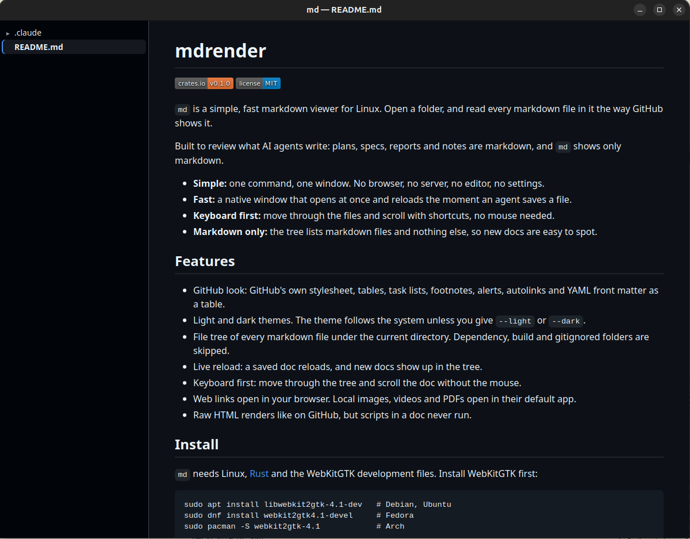

# mdrender

[](https://crates.io/crates/mdrender)
[](LICENSE)

`md` is a simple, fast markdown viewer for Linux. Open a folder, and read every markdown file in it the way GitHub
shows it.



Built to review what AI agents write: plans, specs, reports and notes are markdown, and `md` shows only markdown.

- **Simple:** one command, one window. No browser, no server, no editor, no settings.
- **Fast:** a native window that opens at once and reloads the moment an agent saves a file.
- **Keyboard first:** move through the files and scroll with shortcuts, no mouse needed.
- **Markdown only:** the tree lists markdown files and nothing else, so new docs are easy to spot.

## Features

- GitHub look: GitHub's own stylesheet, tables, task lists, footnotes, alerts, autolinks and YAML front matter as a
  table.
- Light and dark themes. The theme follows the system unless you give `--light` or `--dark`.
- File tree of every markdown file under the current directory. Dependency, build and gitignored folders are skipped.
- Live reload: a saved doc reloads, and new docs show up in the tree.
- Keyboard first: move through the tree and scroll the doc without the mouse.
- Web links open in your browser. Local images, videos and PDFs open in their default app.
- Raw HTML renders like on GitHub, but scripts in a doc never run.

## Install

`md` needs Linux, [Rust](https://rustup.rs) and the WebKitGTK development files. Install WebKitGTK first:

```sh
sudo apt install libwebkit2gtk-4.1-dev   # Debian, Ubuntu
sudo dnf install webkit2gtk4.1-devel     # Fedora
sudo pacman -S webkit2gtk-4.1            # Arch
```

Then install the `md` command into `~/.cargo/bin`:

```sh
cargo install mdrender --locked
```

From a clone, `just install` also installs a desktop entry and a dock icon. It needs [just](https://github.com/casey/just).

## Usage

```sh
md README.md     # open a file
md docs/         # open the tree of a folder, with no document
md --dark notes.md
```

The tree lists the markdown files under the current directory, or under the file's folder if the file is outside it.

| Key                    | Action                               |
|------------------------|--------------------------------------|
| `Ctrl+1` or `Esc`      | Focus the tree                       |
| `Ctrl+2`               | Focus the document                   |
| `Ctrl+W` or `Ctrl+Q`   | Quit                                 |
| `Up` / `Down`          | In the tree: show the previous/next doc |
| `Left` / `Right`       | In the tree: fold/unfold a folder    |
| `Enter`                | In the tree: open the doc and focus it |
| `PageUp` / `PageDown`  | In the tree: scroll the doc by a page |
| `Ctrl+Up` / `Ctrl+Down`| In the tree: scroll the doc by a line |

## Development

```sh
just run README.md   # run the dev build
just test            # run the tests
```

## License

[MIT](LICENSE). The bundled GitHub stylesheets come from
[sindresorhus/github-markdown-css](https://github.com/sindresorhus/github-markdown-css), also under the
[MIT license](assets/github-markdown-css.LICENSE).
